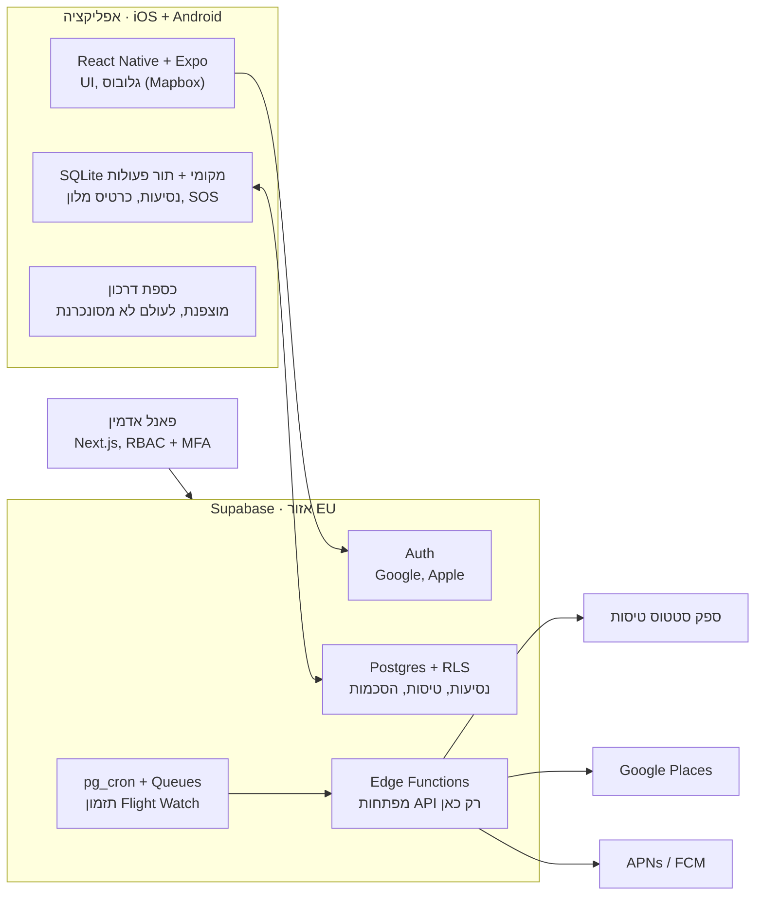

# 3. ארכיטקטורה וסטאק טכנולוגי

ההמלצה: React Native עם Expo (TypeScript) לאפליקציה, Next.js לפאנל האדמין, ו-Supabase כ-Backend מלא – קוד בשפה אחת, טיפוסים משותפים, וצוות אחד שיכול לעבוד על שני הצדדים. Flutter היא חלופה לגיטימית אם לצוות יש בה ניסיון מוכח; ההחלטה הסופית אצל ראש הצוות.

| שכבה | טכנולוגיה מומלצת | למה |
|---|---|---|
| אפליקציית לקוח | React Native + Expo (SDK עדכני), TypeScript | קוד אחד ל-iOS ו-Android, OTA updates, EAS Build |
| גלובוס ומפות | Mapbox Maps SDK בהטלת Globe | גלובוס 3D מסתובב מובנה, תמיכה ב-offline packs |
| אחסון מקומי | SQLite (expo-sqlite) + Secure Store / Keychain / Keystore | Offline-first ואחסון מוצפן של הדרכון |
| פאנל אדמין | Next.js + Supabase Auth (תפקיד admin) | Web, מהיר לפיתוח, אותם טיפוסים |
| Backend | Supabase: Postgres, Auth, Storage, Edge Functions, Realtime | DB מנוהל עם RLS, אימות, פונקציות שרת |
| תזמון משימות | pg_cron + Supabase Queues + Edge Functions | pg_cron מכניס לתור רק טיסות שהגיע זמן הבדיקה שלהן, ו-Edge Functions מעבדות את התור במנות. כך המערכת עומדת בעשרות אלפי טיסות בלי שרת נפרד |
| סנכרון offline | מנגנון ייעודי שנבנה בפרויקט: תור פעולות במכשיר, גרסאות שנקבעות בשרת | השרת קובע את סדר העדכונים, ולא שעון המכשיר (ראו פרק 8) |
| התראות Push | Expo Notifications (APNs + FCM) | ערוץ אחד לשתי הפלטפורמות |
| טיסות | ספק Flight Status API (AeroDataBox / FlightAware AeroAPI / Cirium) | מימוש מאחורי שכבת Adapter כדי שאפשר יהיה להחליף ספק |
| מקומות ותרגום | Google Places API (פרמטר שפה) + Google Translate כגיבוי | שם וכתובת המלון בשפה המקומית |
| ניהול קוד | GitHub + GitHub Actions | PR, CI, הרצת מיגרציות |
| ניטור | Sentry + PostHog (או מקבילה) | קריסות, אנליטיקה מוצרית – בכפוף להסכמה |

**ארכיטקטורה · אפליקציה, Supabase ושירותים חיצוניים**

האפליקציה והאדמין מדברים רק עם Supabase; רק Edge Functions פונות לספקים החיצוניים, וכספת הדרכון מנותקת מכל זה.

**סביבות:**

| סביבה | איפה | מתי |
|---|---|---|
| dev | Supabase מקומי על מחשב הפיתוח (Supabase CLI + Docker) | מספרינט 0 |
| staging | פרויקט ענן (הפרויקט הקיים `travel-app-dev`), תוכנית חינמית | כשיש גרסה ראשונה לבדיקה על מכשירים |
| prod | פרויקט ענן נפרד בתוכנית Pro | לפני הבטא |

אין גישה של מפתחים לדאטה של prod.

**כלל ברזל:** מפתחות API של ספקים חיצוניים (טיסות, Google) נשמרים רק ב-Edge Functions כ-secrets. האפליקציה לעולם לא קוראת לספק ישירות עם מפתח שרת.
