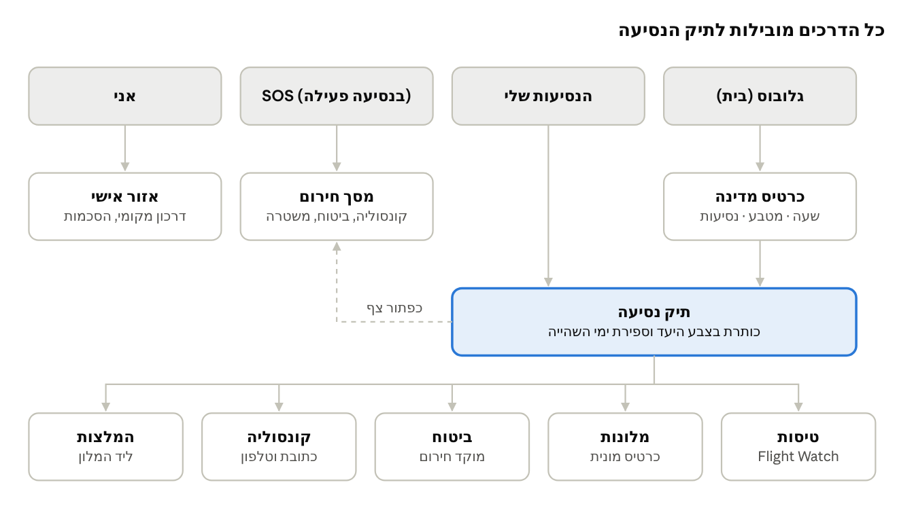

# 12. עיצוב ו-UX

הקונספט: **"כרטיס עלייה למטוס שפוגש גלויה"** – הדיוק והבהירות של עולם התעופה (לוח המראות, כרטיס עלייה, שעונים) עם הצבעוניות והחום של גלויה מחופשה. הממשק משתנה לאורך הנסיעה: מתכנן ורגוע לפני, ממוקד ומהיר ביום הטיסה, ושמח ומגלה ביעד.

## 12.1 עקרונות עיצוב

- **צבעוני, אבל לא רועש:** צבע משמש לרגש ולכיוון – רקעים, איורים, כרטיסי יעד. מידע קריטי (שעה, שער, טלפון חירום) תמיד על רקע נקי ובניגודיות גבוהה.
- **מידע אחד בולט בכל מסך:** הדבר הבא שהנוסע צריך ("עלייה למטוס בעוד 40 דק', שער B12") גדול ובראש המסך.
- **יד אחת, מבט אחד:** פעולות עיקריות באזור האגודל בתחתית המסך, כפתורים בגובה 48pt לפחות.
- **תנועה עם משמעות:** כל אנימציה מסבירה משהו – מאיפה באנו, מה השתנה, לאן הולכים. לא אנימציה לשם קישוט.

## 12.2 שפה ויזואלית

**פלטת צבעים (Design Tokens):**

| טוקן | תפקיד | גוון מוצע |
|---|---|---|
| Sky | צבע ראשי, כפתורים, גלובוס | כחול שמיים בהיר-עמוק |
| Sunset | הדגשה, קריאה לפעולה, נסיעה קרובה | כתום-אלמוג |
| Lagoon | אישור, "הכל מסודר", מצב ביעד | טורקיז |
| Sand | רקעים חמים, כרטיסים | חול בהיר |
| Night Flight | מצב כהה, רקע הגלובוס | כחול-לילה |
| Alert | שינוי טיסה, חירום, SOS | אדום ברור – שמור רק לזה |

- **צבע לפי יעד:** לכל אזור בעולם גוון משני (טרופי, אלפיני, מדברי, אורבני) שצובע את כרטיס המדינה ואת כותרת תיק הנסיעה. מנוהל כשדה בטבלת countries.
- **מצב כהה מלא** ("Night Flight") – גם כי הרבה שימוש קורה בטיסות לילה ובחדרי מלון חשוכים.
- **טיפוגרפיה:** גופן שתומך היטב בעברית ובלטינית (למשל Rubik או Heebo), עם ספרות ברוחב קבוע (tabular) לשעות ומספרי טיסה – תחושת לוח המראות.
- **איורים ואייקונים:** סט אייקונים אחיד בקו מעוגל; איורי יעד בסגנון גלויה (לא תמונות סטוק) לכרטיסי מדינה ולמצבים ריקים.
- ניגודיות בכל הצבעים לפי WCAG AA (4.5:1 לטקסט).

## 12.3 אנימציות ומיקרו-אינטראקציות

| רגע | אנימציה | משך משוער |
|---|---|---|
| פתיחת האפליקציה | הגלובוס מסתובב לאט עם קו יום/לילה אמיתי שזז על פני כדור הארץ, וזוהר עדין סביב האטמוספרה | רציף |
| בחירת מדינה | מעוף מצלמה (Fly-to) אל המדינה, המדינה "מתרוממת" מעט וזוהרת בגוון האזור שלה | 1.2–1.8 שנ' |
| נסיעה קיימת | קשת טיסה מתל אביב ליעד נמתחת על הגלובוס ומטוס קטן עובר לאורכה | 2 שנ', פעם אחת |
| שינוי בשעת טיסה | אפקט לוח המראות (Split-flap) – הספרות מתהפכות לשעה החדשה, בצבע Alert | 0.6–0.8 שנ' |
| ספירה לאחור לטיסה | ספרות Split-flap שמתחלפות כל יום / כל דקה ביום הטיסה | רציף |
| כרטיס טיסה | כרטיס עלייה למטוס עם "ניקוב"; החלקה הופכת אותו (Flip) לצד האחורי עם PNR ומושב | 0.4 שנ' |
| כרטיס כתובת למונית | הכרטיס "עף" מתיק הנסיעה ונפתח למסך מלא תוך סיבוב לרוחב | 0.35 שנ' |
| השלמת תיק נסיעה | חותמת דרכון ננעצת על כרטיס הנסיעה + רטט קל (Haptic) | 0.5 שנ' |
| רקע ביעד | גרדיאנט שמיים לפי השעה המקומית ביעד – זריחה, יום, שקיעה, לילה (מתחבר ל-5.8) | מעבר איטי |
| מעבר בין מסכים | Shared Element: כרטיס המדינה מתרחב והופך לכותרת תיק הנסיעה | 0.3 שנ' |

**מימוש טכני:** React Native Reanimated + Skia לאנימציות שרצות על ה-UI thread, Lottie או Rive לאנימציות מאוירות (חותמת, מטוס), Mapbox camera API למעוף הגלובוס, Expo Haptics לרטט.

**כללים מחייבים:**

- 60fps במכשיר Android בינוני; אנימציה שלא עומדת בזה מקבלת גרסה פשוטה.
- כיבוד הגדרת "הפחתת תנועה" (Reduce Motion) של המכשיר – מעברי Fade במקום תנועה, בלי סיבוב גלובוס.
- אנימציה לעולם לא מעכבת מידע קריטי: במסך SOS ובכרטיס המונית התוכן מוצג מיד.
- רטט רק ברגעים בעלי משמעות (שינוי טיסה, השלמה), לא בכל הקשה.

## 12.4 ממשק שמשתנה לפי זמני השהייה

האפליקציה יודעת באיזה שלב של הנסיעה המשתמש נמצא, ומשנה את מסך הבית, את הכפתורים הבולטים ואת ההתראות בהתאם. כל ההתראות מתוזמנות לפי השעה המקומית במקום שבו המשתמש נמצא, עם "שעות שקט" (22:00–08:00 מקומי) – חוץ משינוי טיסה בחלון 48 השעות.

| שלב | מתי | מה במרכז המסך | התראות יזומות |
|---|---|---|---|
| תכנון | יותר מ-7 ימים לפני | ספירה לאחור, אחוז השלמת התיק, "מה חסר" | תזכורת להוסיף ביטוח אם חסר |
| לפני היציאה | 7 ימים עד יום הטיסה | צ'קליסט: תוקף דרכון, ביטוח, צ'ק-אין, מטבע | צ'ק-אין 24 שעות לפני, תוקף דרכון |
| יום הטיסה | 24 שעות לפני ועד הנחיתה | מצב "לוח המראות": שעה, טרמינל, שער, סטטוס חי | כל שינוי טיסה, "צא לשדה" לפי הזמן |
| הגעה | יום הנחיתה | כרטיס המונית למלון, שעה מקומית, מטבע, SOS | "ברוך הבא ל..." עם 3 דברים שכדאי לדעת |
| בשהייה | ימים 2 עד יום לפני החזרה | "יום 3 מתוך 8", המלצות ליד המלון, שעון ומטבע | המלצה יומית אחת בבוקר המקומי (אופציונלי) |
| יום אחרון | יום לפני החזרה | צ'ק-אאוט, טיסת החזרה, כרטיס מונית לשדה | צ'ק-אין לחזרה, שעת צ'ק-אאוט |
| חזרה | אחרי הנחיתה בארץ | סיכום הנסיעה, ארכיון | בקשת משוב קצרה |

בנסיעה עם כמה ערים או מלונות – "יום X" וכרטיס המונית מתחלפים אוטומטית לפי תאריכי הצ'ק-אין.

## 12.5 מפת מסכים וניווט

- **Tab bar תחתון עם 3 לשוניות קבועות:** גלובוס (בית), הנסיעות שלי, אני. לשונית רביעית "SOS · [יעד]" מופיעה רק בזמן נסיעה פעילה (5.6).
- SOS זמין גם ככפתור צף בתוך כל תיק נסיעה פעיל.
- **תיק נסיעה** הוא המסך המרכזי: כותרת בצבע היעד, שעון + מטבע, ואז כרטיסים: טיסות, מלונות, ביטוח, קונסוליה, המלצות.

מפת מסכים · 4 לשוניות ותיק נסיעה

מהגלובוס ומהנסיעות שלי מגיעים לאותו תיק נסיעה, וממנו לכל חמשת הכרטיסים; מסך החירום זמין גם ככפתור צף מתוך התיק.

## 12.6 תהליך ותוצרי עיצוב

- **Dual-track Agile:** העיצוב עובד ספרינט אחד לפני הפיתוח; כל סטורי נכנס לספרינט עם מסכים מאושרים.
- **כלי העיצוב:** בשלב זה העיצוב נעשה בתוך הפרויקט ולא ב-Figma. מערכת העיצוב מוגדרת כ-Design Tokens בקוד, והמסכים מוצגים כהדמיות HTML לחיצות בגודל טלפון, לאישור יוסי ורז. מעצב אנושי יוכל להמשיך מאותם Tokens בעתיד.
- **הגלובוס הוא לב המוצר:** הוא חייב להיות מושך, מיתוגי ומזמין לשחק איתו (סיבוב, קירוב, בחירת מדינה). לכן הוא נבנה ונבדק ראשון, כאב-טיפוס על מכשיר אמיתי, לפני שאר המסכים.
- אב-טיפוס לחיץ לכל זרימה מרכזית, ספרינט אחד לפני הפיתוח שלה: רישום והסכמות בספרינט 0, יצירת נסיעה בספרינט 2, יום טיסה בספרינט 4, וכרטיס מונית בספרינט 6.
- בדיקות שמישות עם 5 משתמשים לכל פרסונה לפני ספרינט 3 ולפני הבטא.
- מפרט אנימציות (משך, Easing, טריגר) מצורף לכל מסך – אנימציה לא מתועדת לא נכנסת לפיתוח.
